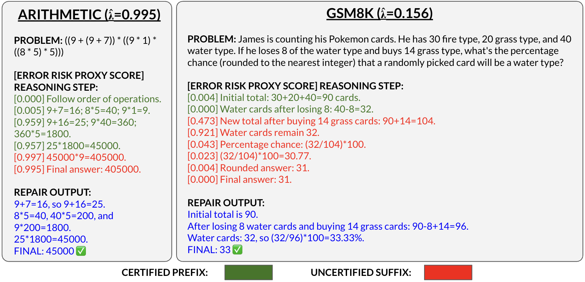

# Conformal Certification of Reasoning Trace Prefixes
**EMNLP 2026 Main Conference — Oral Presentation**



CROP identifies the longest trustworthy prefix of a multi-step reasoning
trace. It works with any verifier that assigns an error-risk score to each
step, and uses conformal risk control to calibrate where the trace should be
cut. The retained prefix can be reused while the remaining suffix is sent for
review, regeneration, or repair.

## Abstract

Language model reasoning traces are rarely all-or-nothing: they frequently
contain valid intermediate steps before a critical error occurs. Existing
uncertainty quantification methods typically certify final answers or entire
responses, but do not provide statistical guarantees for how much of a
sequential trace can be safely retained.

We introduce CROP (Conformal Reasoning Output Prefixes), a verifier-agnostic
calibration procedure for clean-prefix certification. Given any step-level
risk proxy, CROP selects a calibrated threshold and returns the longest
contiguous prefix whose scores remain below it. Assuming exchangeability,
CROP controls the marginal probability that the returned prefix contains an
annotated error. Across six process-labeled reasoning datasets, we find that
standard step-level metrics such as AUROC do not fully capture prefix utility.
CROP also improves downstream repair by preserving useful intermediate
reasoning while discarding misleading suffixes.

## How it works

The example below is taken from the demo notebook. Scores must be oriented so
that larger values indicate greater error risk, and calibration/test splits
must be made over complete traces.

```python
import numpy as np

from crop import fit_prefix_calibrator
from crop.data import make_toy_traces

# Replace these synthetic traces and scores with outputs from your verifier.
rng = np.random.default_rng(7)
traces = make_toy_traces(n_traces=600, seed=7, error_rate=0.12)
scores = [
    np.clip(0.15 + 0.65 * trace.y_errors + rng.normal(0, 0.18, len(trace.steps)), 0, 1)
    for trace in traces
]

cal_traces, test_traces = traces[:300], traces[300:]
cal_scores, test_scores = scores[:300], scores[300:]

crop = fit_prefix_calibrator(cal_traces, cal_scores, alpha=0.05)
retained_lengths = crop.predict(test_scores)
certified_prefixes = [
    trace.steps[:length]
    for trace, length in zip(test_traces, retained_lengths)
]
```

`alpha` is the desired risk level. For each new trace, CROP returns the number
of initial steps to retain.

## Installation

```bash
git clone https://github.com/matthewyccheung/crop.git
cd crop
python -m venv .venv
source .venv/bin/activate
python -m pip install -U pip
python -m pip install -e ".[demo]"
```

## Demo

Open the self-contained, CPU-only tutorial:

```bash
jupyter lab examples/crop_quickstart.ipynb
```

The notebook walks through data preparation, calibration, prefix
certification, evaluation, and alpha sensitivity. It does not require a model
download or external dataset.

The core CROP algorithm is only a few operations:

```python
import numpy as np

from crop.risk_control import prefix_lengths, prefix_losses_by_lambda, select_lambda_crc

lambdas = np.r_[-np.inf, np.unique(np.concatenate(calibration_scores))]
losses = prefix_losses_by_lambda(calibration_traces, calibration_scores, lambdas)
lambda_hat, risk = select_lambda_crc(losses, lambdas, alpha=0.05, direction="increasing")
certified_lengths = prefix_lengths(test_scores, lambda_hat)
```

For a concise implementation from first principles, open the standalone
[algorithm notebook](examples/crop_algorithm.ipynb):

```bash
jupyter lab examples/crop_algorithm.ipynb
```

## Reproducing the paper results

Install the experiment dependencies:

```bash
python -m pip install -e ".[demo,dev]"
```

Download the companion paper caches using the URL provided with the release (TODO, but these can be recreated with the code base):

```bash
python scripts/download_artifacts.py --base-url "$CROP_ARTIFACT_URL"
python scripts/download_artifacts.py --verify-only
```

Rebuild the main cached results:

```bash
bash scripts/run_external_fixed_score_60_20_20.sh
python scripts/build_fixed_score_table.py
python scripts/make_compact_auroc_prefix_figure.py
python scripts/build_boundary_deviation_table.py
```

See [docs/REPRODUCIBILITY.md](docs/REPRODUCIBILITY.md) for the complete
experiment commands, including feature extraction, PRM scoring, and
downstream repair.

## Tests

```bash
PYTEST_DISABLE_PLUGIN_AUTOLOAD=1 python -m pytest -q
```

## Citation
```
@article{cheung2026conformal,
  title={Conformal Certification of Reasoning Trace Prefixes},
  author={Cheung, Matt Y and Veeraraghavan, Ashok and Chen, Hanjie and Balakrishnan, Guha},
  journal={arXiv preprint arXiv:2605.30085},
  year={2026}
}
```

## License

The code is released under the MIT License. Datasets and model checkpoints
retain their original licenses.
